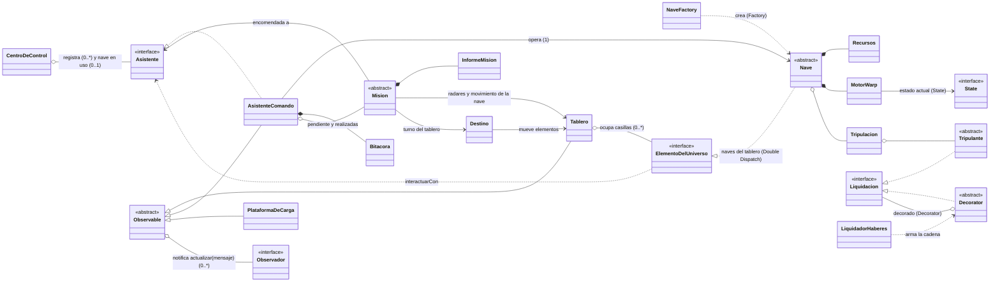
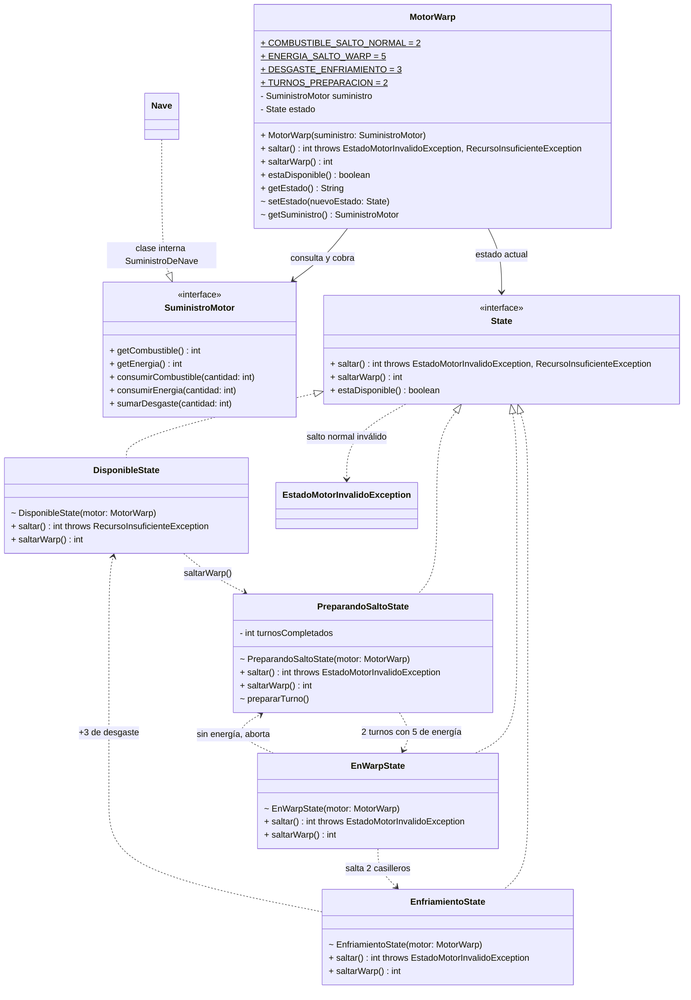
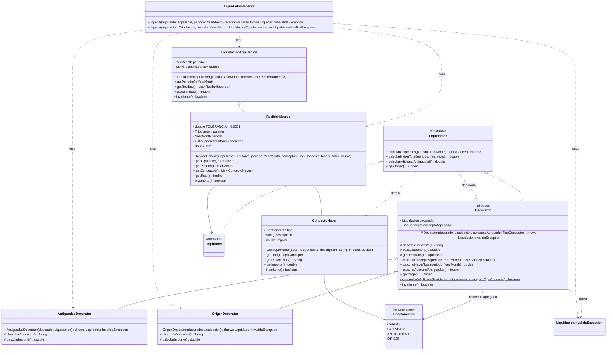
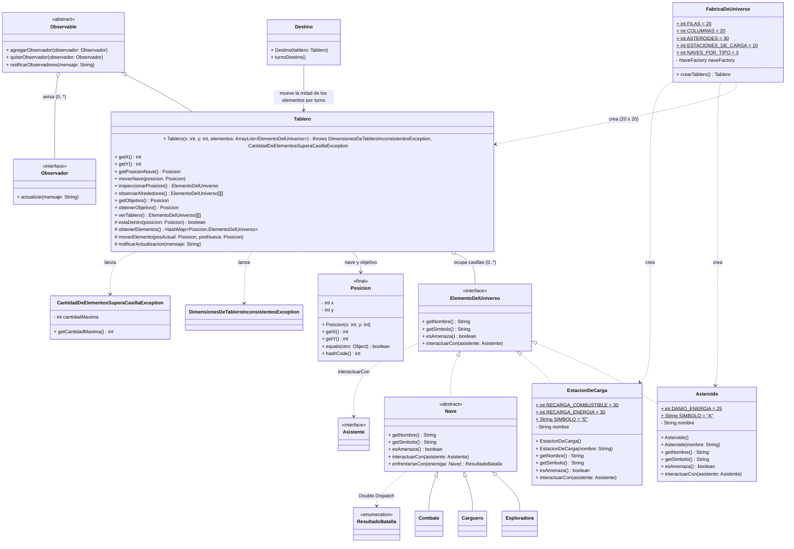
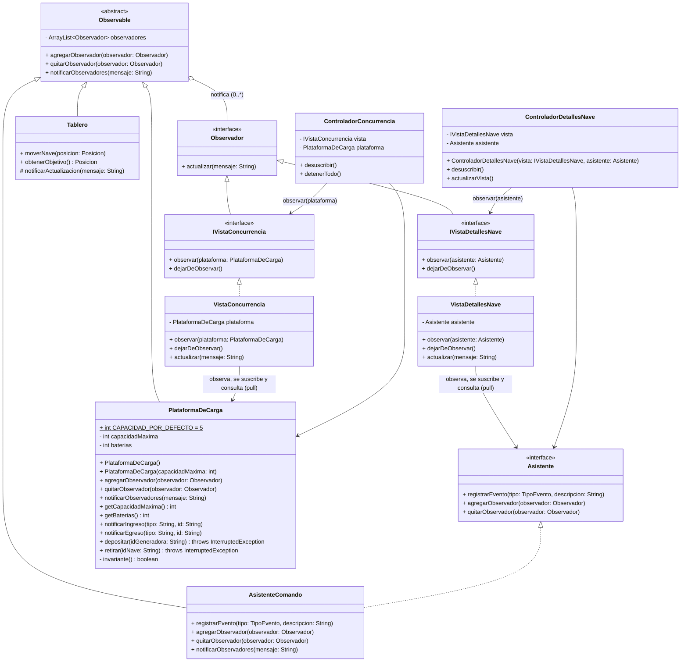

# Diagrama de clases — Entrega 1 y Entrega 2 (en desarrollo)

Primero una **vista general** con las clases y sus relaciones principales; después, un diagrama por módulo con
atributos, métodos y excepciones, tal como están en el código.

**Notación:** `+` público, `-` privado, `#` protegido, `~` de paquete; `*` al final = abstracto; `$` al final = estático
(las constantes son `static final`). Se omiten `toString()`, los constructores por defecto sin código y los constructores privados de los `enum`.
`throws` indica las excepciones comprobadas que el método declara. Flecha continua (`-->`, `*--`, `o--`) = el atributo
existe; flecha punteada (`..>`) = dependencia (usa, crea o lanza). `App` (demostración por consola) no forma parte del modelo.

## 1. Vista general

## 2. Nave y fábrica (E1-01, E1-07 Factory, E1-09)

```mermaid
classDiagram
    class Nave {
        <<abstract>>
        - int ultimoIdAsignado$
        - int id
        - Recursos recursos
        - MotorWarp motor
        - Tripulacion tripulacion
        - boolean destruida
        - int gemas
        - int combustibleEntregado
        - int energiaEntregada
        ~ Nave(combustibleInicial: int, energiaInicial: int, desgasteInicial: int)
        + getTipo() TipoNave*
        + enfrentarseCon(enemiga: Nave) ResultadoBatalla*
        ~ serEnfrentadaPorExploradora(propia: Exploradora) ResultadoBatalla*
        ~ serEnfrentadaPorCarguero(propia: Carguero) ResultadoBatalla*
        ~ serEnfrentadaPorCombate(propia: Combate) ResultadoBatalla*
        + aplicarResultado(resultado: ResultadoBatalla)
        + getNombre() String
        + getSimbolo() String
        + esAmenaza() boolean
        + interactuarCon(asistente: Asistente)
        + getId() int
        + getMotor() MotorWarp
        + getTripulacion() Tripulacion
        + asignarTripulacion(nuevaTripulacion: Tripulacion)
        + getCombustible() int
        + getEnergia() int
        + getDesgaste() int
        + requiereMantenimiento() boolean
        + estaListaParaOperar() boolean
        + estaDestruida() boolean
        + tripulacionConVida() boolean
        + cargarCombustible(cantidad: int) throws CantidadInvalidaException, CapacidadExcedidaException
        + cargarEnergia(cantidad: int) throws CantidadInvalidaException, CapacidadExcedidaException
        + consumirRecursos(combustible: int, energia: int, desgaste: int) throws CantidadInvalidaException, RecursoInsuficienteException, CapacidadExcedidaException
        + recibirImpacto(energia: int)
        + reabastecer(combustible: int, energia: int)
        + realizarMantenimiento()
        + getGemas() int
        + acreditarGemas(cantidad: int)
        + getCombustibleEntregado() int
        + getEnergiaEntregada() int
        + entregarSuministros(combustible: int, energia: int) throws CantidadInvalidaException, RecursoInsuficienteException
        - actualizarDestruccion()
        - invariante() boolean
    }
    class Exploradora {
        - int COMBUSTIBLE_INICIAL = 60$
        - int ENERGIA_INICIAL = 80$
        - int DESGASTE_INICIAL = 0$
        ~ Exploradora()
        + getTipo() TipoNave
        + enfrentarseCon(enemiga: Nave) ResultadoBatalla
        ~ serEnfrentadaPorExploradora(propia: Exploradora) ResultadoBatalla
        ~ serEnfrentadaPorCarguero(propia: Carguero) ResultadoBatalla
        ~ serEnfrentadaPorCombate(propia: Combate) ResultadoBatalla
    }
    class Carguero {
        - int COMBUSTIBLE_INICIAL = 100$
        - int ENERGIA_INICIAL = 60$
        - int DESGASTE_INICIAL = 0$
        ~ Carguero()
        + getTipo() TipoNave
        + enfrentarseCon(enemiga: Nave) ResultadoBatalla
        ~ serEnfrentadaPorExploradora(propia: Exploradora) ResultadoBatalla
        ~ serEnfrentadaPorCarguero(propia: Carguero) ResultadoBatalla
        ~ serEnfrentadaPorCombate(propia: Combate) ResultadoBatalla
    }
    class Combate {
        - int COMBUSTIBLE_INICIAL = 80$
        - int ENERGIA_INICIAL = 100$
        - int DESGASTE_INICIAL = 0$
        ~ Combate()
        + getTipo() TipoNave
        + enfrentarseCon(enemiga: Nave) ResultadoBatalla
        ~ serEnfrentadaPorExploradora(propia: Exploradora) ResultadoBatalla
        ~ serEnfrentadaPorCarguero(propia: Carguero) ResultadoBatalla
        ~ serEnfrentadaPorCombate(propia: Combate) ResultadoBatalla
    }
    class NaveFactory {
        + crearNave(tipo: TipoNave) Nave
    }
    class TipoNave {
        <<enumeration>>
        EXPLORADORA
        CARGUERO
        COMBATE
        - String descripcion
        - String simbolo
        + getDescripcion() String
        + getSimbolo() String
    }
    class ResultadoBatalla {
        <<enumeration>>
        GANA
        PIERDE
        PACTO_DE_PAZ
        - String descripcion
        - boolean destruyeNavePropia
        + getDescripcion() String
        + destruyeNavePropia() boolean
    }
    class Recursos {
        <<paquete>>
        ~ int CAPACIDAD_MAXIMA_COMBUSTIBLE = 100$
        ~ int CAPACIDAD_MAXIMA_ENERGIA = 100$
        ~ int DESGASTE_MAXIMO = 100$
        ~ int UMBRAL_MANTENIMIENTO = 80$
        - int combustible
        - int energia
        - int desgaste
        ~ Recursos(combustibleInicial: int, energiaInicial: int, desgasteInicial: int)
        ~ getCombustible() int
        ~ getEnergia() int
        ~ getDesgaste() int
        ~ requiereMantenimiento() boolean
        ~ agotados() boolean
        ~ cargarCombustible(cantidad: int) throws CantidadInvalidaException, CapacidadExcedidaException
        ~ cargarEnergia(cantidad: int) throws CantidadInvalidaException, CapacidadExcedidaException
        ~ consumir(combustibleConsumido: int, energiaConsumida: int, desgasteProducido: int) throws CantidadInvalidaException, RecursoInsuficienteException, CapacidadExcedidaException
        ~ sumarDesgaste(cantidad: int)
        ~ descontarEnergia(cantidad: int)
        ~ reabastecer(cantidadCombustible: int, cantidadEnergia: int)
        ~ realizarMantenimiento()
        - validarCantidad(recurso: TipoRecurso, cantidad: int) throws CantidadInvalidaException
        - invariante() boolean
    }
    class TipoRecurso {
        <<enumeration>>
        COMBUSTIBLE
        ENERGIA
        DESGASTE
    }
    class MotorWarp
    class Tripulacion
    class CantidadInvalidaException
    class CapacidadExcedidaException
    class RecursoInsuficienteException
    class ElementoDelUniverso
    <<interface>> ElementoDelUniverso
    class Asistente
    <<interface>> Asistente

    ElementoDelUniverso <|.. Nave
    Nave <|-- Exploradora
    Nave <|-- Carguero
    Nave <|-- Combate
    NaveFactory ..> Exploradora : crea
    NaveFactory ..> Carguero : crea
    NaveFactory ..> Combate : crea
    NaveFactory ..> TipoNave
    Nave ..> TipoNave
    Nave *-- Recursos : composición
    Nave *-- MotorWarp : composición
    Nave o-- Tripulacion : agregación (0..1)
    Recursos ..> TipoRecurso
    Recursos ..> CantidadInvalidaException : lanza
    Recursos ..> CapacidadExcedidaException : lanza
    Recursos ..> RecursoInsuficienteException : lanza
    Nave ..> ResultadoBatalla : enfrentarseCon (Double Dispatch)
    Nave ..> Asistente : interactuarCon (ida)
```

**Double Dispatch (Enunciado E2, punto A).** La nave enemiga del tablero recibe `interactuarCon(asistente)` y le pide
al asistente `enfrentarseCon(this)`; el asistente invoca `enfrentarseCon(enemiga)` sobre la nave propia (ida), y cada
subclase responde con `enemiga.serEnfrentadaPor<SuTipo>(this)` (vuelta). Cada subclase implementa los tres métodos de
vuelta con su **columna** de la tabla (resultado para la nave propia): `Exploradora` paz / pierde / gana, `Carguero`
gana / paz / pierde, `Combate` pierde / gana / paz (propia Exploradora / Carguero / Combate). Sin `instanceof`,
`getClass()` ni condicionales de tipo.

**La nave no es observable (Paso 4 de la E2).** Toda orden a la nave pasa por su asistente (Aclaración, R2), que es el
sujeto que notifica (secciones 5 y 10). Si la nave también notificara, cada cambio llegaría dos veces.

## 3. Motor Warp (E1-02, patrón State)

Cada estado concreto implementa sin `throws` su única transición válida y rechaza las otras tres con
`EstadoMotorInvalidoException`. Los constructores de los estados y `setEstado()` son de paquete: sólo el motor y los
estados pueden cambiar el estado.

## 4. Misión (E1-06 y Enunciado E2: Template Method; E1-10 y Fase 3: informe)

```mermaid
classDiagram
    class Mision {
        <<abstract>>
        + int ENERGIA_ESCANEO_LARGO = 5$
        + int ENERGIA_ESCANEO_CORTO = 1$
        + int ENERGIA_RECALCULO = 2$
        + int DESGASTE_POR_CELDA = 1$
        + int PAUSA_POR_TURNO_MS = 400$
        - String codigo
        - String nombre
        - Tablero tablero
        - Destino destino
        - Navegador navegador
        - List~String~ acciones
        - List~Posicion~ recorrido
        - LinkedList~Posicion~ rutaPlanificada
        - Asistente asistente
        - EtapaMision etapa
        - int pausaPorTurno
        - Posicion objetivo
        - boolean llegoAlObjetivo
        - boolean verificadaEnDestino
        - boolean travesiaInterrumpida
        - boolean exitosa
        - InformeMision informe
        - int combustibleConsumido, energiaConsumida, desgasteProducido
        - int combustiblePerdido, energiaPerdida, combustibleGanado, energiaGanada
        # Mision(codigo: String, nombre: String, tablero: Tablero, destino: Destino)
        # fijarObjetivo(tablero: Tablero) Posicion*
        # getEnergiaAdicional() int*
        # realizarAccion()*
        # getCondicionDeExito() String*
        # getCombustibleAEntregar() int
        # getEnergiaAEntregar() int
        # getGemasObtenidas() int
        # aplicarCierre()
        + asignarAsistente(asistente: Asistente)
        + configurarPausaPorTurno(milisegundos: int)
        + realizar() InformeMision throws NaveNoDisponibleException, RecursoInsuficienteException
        - preparar() throws NaveNoDisponibleException, RecursoInsuficienteException
        - ejecutar()
        - turnoDeLaNave(turno: int) boolean
        - interactuarCon(elemento: ElementoDelUniverso, turno: int)
        - escanearCortoAlcance() ElementoDelUniverso[][]
        - planificarYSaltar(alrededores: ElementoDelUniverso[][], turno: int) boolean
        - cobrarSalto(warp: boolean) int
        - avanzar(casilleros: int, alrededores: ElementoDelUniverso[][], turno: int)
        - proximoPaso(alrededores: ElementoDelUniverso[][], turno: int) Posicion
        - recalcularRuta(turno: int, motivo: String)
        - moverA(siguiente: Posicion, turno: int, tipoDeSalto: String)
        - completarManiobraWarp()
        - verificarEnDestino()
        - pausar()
        - consumir(combustible: int, energia: int, desgaste: int)
        - evaluar()
        - cerrar()
        # registrarAccion(descripcion: String)
        + getCodigo() String
        + getNombre() String
        + getEtapa() EtapaMision
        + getCombustibleMinimo() int
        + getEnergiaMinima() int
        + getPausaPorTurno() int
        + getObjetivo() Posicion
        + getRuta() List~Posicion~
        + getAsistente() Asistente
        + getInforme() InformeMision
        - invariante() boolean
    }
    note for Mision "realizar() y registrarAccion() son final. realizar() es el método plantilla: preparar, ejecutar, evaluar y cerrar, en ese orden. Los métodos # sin * son ganchos con implementación por defecto."
    class Navegador {
        <<final>>
        ~ calcularRuta(mapa: ElementoDelUniverso[][], origen: Posicion, objetivo: Posicion) List~Posicion~
        ~ estaDentro(posicion: Posicion, filas: int, columnas: int) boolean$
        ~ sonVecinas(una: Posicion, otra: Posicion) boolean$
    }
    class MisionIntercepcion {
        + int ENERGIA_ADICIONAL = 5$
        + int SUMINISTRO_MINIMO = 5$
        + int SUMINISTRO_MAXIMO = 20$
        - int combustibleAEntregar
        - int energiaAEntregar
        + MisionIntercepcion(tablero: Tablero, destino: Destino)
        + MisionIntercepcion(tablero: Tablero, destino: Destino, azar: Random)
        # fijarObjetivo(tablero: Tablero) Posicion
        # getEnergiaAdicional() int
        + getCombustibleAEntregar() int
        + getEnergiaAEntregar() int
        # realizarAccion()
        # aplicarCierre()
        # getCondicionDeExito() String
    }
    class MisionRecoleccion {
        + int ENERGIA_ADICIONAL = 5$
        + int GEMAS_MINIMAS = 60$
        + int GEMAS_MAXIMAS = 100$
        - Random azar
        - int gemasObtenidas
        + MisionRecoleccion(tablero: Tablero, destino: Destino)
        + MisionRecoleccion(tablero: Tablero, destino: Destino, azar: Random)
        # fijarObjetivo(tablero: Tablero) Posicion
        # getEnergiaAdicional() int
        # realizarAccion()
        + getGemasObtenidas() int
        # aplicarCierre()
        # getCondicionDeExito() String
    }
    class MisionRetorno {
        - int ENERGIA_ADICIONAL = 0$
        + int RECARGA_EN_BASE = 100$
        + MisionRetorno(tablero: Tablero, destino: Destino)
        # fijarObjetivo(tablero: Tablero) Posicion
        # getEnergiaAdicional() int
        # realizarAccion()
        # aplicarCierre()
        # getCondicionDeExito() String
    }
    class EtapaMision {
        <<enumeration>>
        CREADA
        PREPARADA
        EJECUTADA
        EVALUADA
        CERRADA
    }
    class InformeMision {
        - String mision
        - boolean exitosa
        - List~String~ acciones
        - Posicion objetivo
        - List~Posicion~ ruta
        - BalanceRecursos balance
        - int combustibleFinal
        - int energiaFinal
        - int desgasteFinal
        - String estadoMotorFinal
        - boolean naveOperativa
        - String observaciones
        ~ InformeMision(mision, exitosa, acciones, objetivo, ruta, balance, combustibleFinal, energiaFinal, desgasteFinal, estadoMotorFinal, naveOperativa, observaciones)
        + getMision() String
        + isExitosa() boolean
        + getAcciones() List~String~
        + getObjetivo() Posicion
        + getRuta() List~Posicion~
        + getBalance() BalanceRecursos
        + getCombustibleConsumido() int
        + getEnergiaConsumida() int
        + getDesgasteProducido() int
        + getCombustibleFinal() int
        + getEnergiaFinal() int
        + getDesgasteFinal() int
        + getEstadoMotorFinal() String
        + isNaveOperativa() boolean
        + getObservaciones() String
        - invariante() boolean
    }
    class BalanceRecursos {
        <<final>>
        - int combustibleConsumido, energiaConsumida, desgasteProducido
        - int combustiblePerdido, energiaPerdida
        - int combustibleGanado, energiaGanada
        - int gemasObtenidas, combustibleEntregado, energiaEntregada
        ~ BalanceRecursos(...10 valores...)
        + getCombustibleConsumido() int
        + getEnergiaConsumida() int
        + getDesgasteProducido() int
        + getCombustiblePerdido() int
        + getEnergiaPerdida() int
        + getCombustibleGanado() int
        + getEnergiaGanada() int
        + getGemasObtenidas() int
        + getCombustibleEntregado() int
        + getEnergiaEntregada() int
        - invariante() boolean
    }
    class Asistente
    <<interface>> Asistente
    class Tablero
    class Destino
    class ElementoDelUniverso
    <<interface>> ElementoDelUniverso
    class NaveNoDisponibleException
    class RecursoInsuficienteException

    Mision <|-- MisionIntercepcion
    Mision <|-- MisionRecoleccion
    Mision <|-- MisionRetorno
    Mision --> EtapaMision
    Mision --> Asistente : encomendada a (0..1)
    Mision --> Tablero : radares (verTablero, observarAlrededores) y moverNave
    Mision --> Destino : turnoDestino() en cada turno
    Mision *-- Navegador : planifica la ruta
    Mision *-- InformeMision : confecciona al evaluar
    InformeMision *-- BalanceRecursos
    Navegador ..> ElementoDelUniverso : esAmenaza()
    Mision ..> ElementoDelUniverso : inspeccionarPosicion() e interactuarCon
    Mision ..> NaveNoDisponibleException : lanza
    Mision ..> RecursoInsuficienteException : lanza
```

**Ciclo de travesía (Enunciado E2, Fase 2).** `ejecutar()` cobra el despegue (escaneo de largo alcance) y repite, mientras
la nave no esté destruida, no haya llegado y pueda avanzar (con un tope de x·y turnos):

1. **Turno de la nave:** `tablero.inspeccionarPosicion()` y, si hay elemento, `elemento.interactuarCon(asistente)`;
   `tablero.observarAlrededores()` (radar de corto alcance, 1 de energía); el `Navegador` da el próximo paso de la ruta y, si
   el radar ve una amenaza en él, se recalcula con `tablero.verTablero()` (2 de energía); el asistente ordena `saltar()` o un
   turno de `saltarWarp()` (Anexo) y la misión mueve la nave con `tablero.moverNave(...)` a una casilla vecina dentro del
   tablero (dos casillas en el turno del salto warp), con 1 de desgaste por casilla.
2. **Turno del tablero:** `destino.turnoDestino()`.
3. **Pausa:** `Thread.sleep(pausaPorTurno)`; si se interrumpe, se restaura la interrupción y termina la travesía.

Al llegar, completa el enfriamiento si llegó con warp, verifica en destino los recursos de la acción final y la entrega, y
realiza la acción. `evaluar()` confecciona el informe con el balance; `cerrar()` aplica `aplicarCierre()` si fue exitosa.

## 5. Asistente, centro de control y Bitácora (E1-03, E1-05; Aclaración R1, R2, R4 y R5)

```mermaid
classDiagram
    class Asistente {
        <<interface>>
        + getNave() Nave
        + getIdNave() int
        + getTipoNave() TipoNave
        + getCombustible() int
        + getEnergia() int
        + getDesgaste() int
        + requiereMantenimiento() boolean
        + tieneTripulacion() boolean
        + naveListaParaOperar() boolean
        + naveDestruida() boolean
        + getGemas() int
        + getEstadoMotor() String
        + motorDisponible() boolean
        + getEventos() List~Evento~
        + registrarEvento(tipo: TipoEvento, descripcion: String)
        + asignarTripulacion(tripulacion: Tripulacion)
        + cargarCombustible(cantidad: int) throws CantidadInvalidaException, CapacidadExcedidaException
        + cargarEnergia(cantidad: int) throws CantidadInvalidaException, CapacidadExcedidaException
        + realizarMantenimiento()
        + consumirRecursos(combustible: int, energia: int, desgaste: int) throws CantidadInvalidaException, RecursoInsuficienteException, CapacidadExcedidaException
        + recibirImpacto(energia: int)
        + reabastecer(combustible: int, energia: int)
        + enfrentarseCon(enemiga: Nave) ResultadoBatalla
        + acreditarGemas(cantidad: int)
        + entregarSuministros(combustible: int, energia: int) throws CantidadInvalidaException, RecursoInsuficienteException
        + saltar() int throws EstadoMotorInvalidoException, RecursoInsuficienteException
        + saltarWarp() int
        + tieneMisionPendiente() boolean
        + getMisionPendiente() Mision
        + estaEjecutando(mision: Mision) boolean
        + getMisionesRealizadas() List~Mision~
        + encomendarMision(mision: Mision)
        + cancelarMision()
        + ejecutarMision() InformeMision throws NaveNoDisponibleException, RecursoInsuficienteException
        + agregarObservador(observador: Observador)
        + quitarObservador(observador: Observador)
    }
    class AsistenteComando {
        - Nave nave
        - Bitacora bitacora
        - List~Mision~ misionesRealizadas
        - Mision misionPendiente
        - Mision misionEnEjecucion
        + AsistenteComando(nave: Nave)
        + getNave() Nave
        + getIdNave() int
        + getTipoNave() TipoNave
        + getCombustible() int
        + getEnergia() int
        + getDesgaste() int
        + requiereMantenimiento() boolean
        + tieneTripulacion() boolean
        + naveListaParaOperar() boolean
        + naveDestruida() boolean
        + getGemas() int
        + getEstadoMotor() String
        + motorDisponible() boolean
        + getEventos() List~Evento~
        + registrarEvento(tipo: TipoEvento, descripcion: String)
        + asignarTripulacion(tripulacion: Tripulacion)
        + cargarCombustible(cantidad: int) throws CantidadInvalidaException, CapacidadExcedidaException
        + cargarEnergia(cantidad: int) throws CantidadInvalidaException, CapacidadExcedidaException
        + realizarMantenimiento()
        + consumirRecursos(combustible: int, energia: int, desgaste: int) throws CantidadInvalidaException, RecursoInsuficienteException, CapacidadExcedidaException
        + recibirImpacto(energia: int)
        + reabastecer(combustible: int, energia: int)
        + enfrentarseCon(enemiga: Nave) ResultadoBatalla
        + acreditarGemas(cantidad: int)
        + entregarSuministros(combustible: int, energia: int) throws CantidadInvalidaException, RecursoInsuficienteException
        + saltar() int throws EstadoMotorInvalidoException, RecursoInsuficienteException
        + saltarWarp() int
        + tieneMisionPendiente() boolean
        + getMisionPendiente() Mision
        + estaEjecutando(mision: Mision) boolean
        + getMisionesRealizadas() List~Mision~
        + encomendarMision(mision: Mision)
        + cancelarMision()
        + ejecutarMision() InformeMision throws NaveNoDisponibleException, RecursoInsuficienteException
        + agregarObservador(observador: Observador)
        + quitarObservador(observador: Observador)
        + notificarObservadores(mensaje: String)
        - registrarInforme(informe: InformeMision)
        - registrarSiFueDestruida(destruidaAntes: boolean, causa: String)
        - registrarRechazoDelMotor(e: EstadoMotorInvalidoException)
        - invariante() boolean
    }
    class CentroDeControl {
        - List~Asistente~ asistentes
        - Asistente asistenteEnUso
        + CentroDeControl()
        + registrar(asistente: Asistente) throws NaveYaRegistradaException
        + buscar(idNave: int) Asistente throws NaveInexistenteException
        + seleccionar(idNave: int) Asistente throws NaveInexistenteException
        + hayNaveEnUso() boolean
        + getAsistenteEnUso() Asistente
        + getAsistentes() List~Asistente~
        + getCantidadNaves() int
        - estaRegistrada(idNave: int) boolean
        - invariante() boolean
    }
    class Bitacora {
        - List~Evento~ eventos
        + registrarEvento(evento: Evento)
        + getEventos() List~Evento~
        - invariante() boolean
    }
    class Evento {
        - LocalDateTime fechaHora
        - TipoEvento tipo
        - String descripcion
        + Evento(fechaHora: LocalDateTime, tipo: TipoEvento, descripcion: String)
        + Evento(tipo: TipoEvento, descripcion: String)
        + getFechaHora() LocalDateTime
        + getTipo() TipoEvento
        + getDescripcion() String
        - invariante() boolean
    }
    class TipoEvento {
        <<enumeration>>
        MOTOR
        MISION
        RECURSO
        ERROR
        SISTEMA
        RELEVANTE
    }
    class Nave
    <<abstract>> Nave
    class Mision
    <<abstract>> Mision
    class NaveYaRegistradaException
    class NaveInexistenteException
    class Observable
    <<abstract>> Observable
    class Observador
    <<interface>> Observador

    Asistente <|.. AsistenteComando
    Observable <|-- AsistenteComando : sujeto (Observer)
    Asistente ..> Observador : agregarObservador / quitarObservador
    AsistenteComando --> Nave : opera (1)
    AsistenteComando *-- Bitacora : composición
    AsistenteComando o-- Mision : pendiente (0..1), en ejecución (0..1) y realizadas (0..*)
    CentroDeControl o-- Asistente : registra (0..*) y nave en uso (0..1)
    CentroDeControl ..> NaveYaRegistradaException : lanza
    CentroDeControl ..> NaveInexistenteException : lanza
    Bitacora *-- Evento : composición
    Evento --> TipoEvento
```

El asistente no conoce el tablero: la posición de la nave es estado del `Tablero`, que maneja la misión (sección 4).
`Bitacora` y `Evento` rechazan los eventos nulos, vacíos o fuera de orden con `IllegalArgumentException`
(excepción no comprobada, por eso no figura en `throws`).

**Sujeto observable (Paso 4 de la E2).** `AsistenteComando` extiende `Observable` de la cátedra y notifica en
`registrarEvento`, su único punto de notificación: cada entrada de la Bitácora (recursos, motor, tripulación, rechazos,
destrucción y cierre del informe) produce exactamente un `actualizar(descripcion)`. Los clientes se suscriben a través de
la interfaz `Asistente`, sin depender de la clase concreta. Los tres métodos del Observer se redefinen como `synchronized`
delegando en `Observable` (detalle en la sección 10).

## 6. Tripulación (E1-04)

```mermaid
classDiagram
    class Tripulacion {
        + int TRIPULANTES_ADICIONALES_MINIMOS = 4$
        + int TAMANIO_MINIMO = 5$
        - List~Tripulante~ tripulantes
        + Tripulacion(integrantes: List~Tripulante~) throws TripulacionInvalidaException
        + incorporar(tripulante: Tripulante) throws TripulacionInvalidaException
        + desembarcar(tripulante: Tripulante) throws TripulacionInvalidaException
        + buscarPorId(id: int) Tripulante throws TripulanteInexistenteException
        + getCapitan() Tripulante
        + getTripulantes() List~Tripulante~
        + getTripulantes(cargo: Cargo) List~Tripulante~
        + getCantidad() int
        - validarIncorporacion(tripulante: Tripulante) throws TripulacionInvalidaException
        - contarCapitanes() int
        - invariante() boolean
    }
    class Tripulante {
        <<abstract>>
        - int ultimoIdAsignado$
        - int id
        - String nombre
        - int antiguedad
        - Origen origen
        # Tripulante(nombre: String, antiguedad: int, origen: Origen) throws TripulanteInvalidoException
        - siguienteId() int$
        + getCargo() Cargo*
        # getRemuneracionCargo() double*
        + calcularAdicionalAntiguedad() double*
        + calcularConceptos(periodo: YearMonth) List~ConceptoHaber~
        + calcularHaberTotal(periodo: YearMonth) double
        + incrementarAntiguedad()
        + getId() int
        + getNombre() String
        + getAntiguedad() int
        + getOrigen() Origen
        - invariante() boolean
    }
    class Capitan {
        - double REMUNERACION_CARGO = 1000$
        - double PORCENTAJE_ANTIGUEDAD_ANUAL = 0.20$
        + Capitan(nombre: String, antiguedad: int, origen: Origen) throws TripulanteInvalidoException
        + getCargo() Cargo
        # getRemuneracionCargo() double
        + calcularAdicionalAntiguedad() double
    }
    class Consejero {
        - double REMUNERACION_CARGO = 600$
        - double PORCENTAJE_ANTIGUEDAD_ANUAL = 0.05$
        - double IMPORTE_POR_CONSEJO = 2$
        - List~YearMonth~ periodosDeConsejos
        + Consejero(nombre: String, antiguedad: int, origen: Origen) throws TripulanteInvalidoException
        + getCargo() Cargo
        # getRemuneracionCargo() double
        + calcularAdicionalAntiguedad() double
        + registrarConsejo(periodo: YearMonth) throws LiquidacionInvalidaException
        + getCantidadConsejos(periodo: YearMonth) int
        + calcularAdicionalConsejos(periodo: YearMonth) double
        + calcularConceptos(periodo: YearMonth) List~ConceptoHaber~
        - invarianteConsejos() boolean
    }
    class Teniente {
        - double REMUNERACION_CARGO = 400$
        - double PORCENTAJE_ANTIGUEDAD_ANUAL = 0.03$
        + Teniente(nombre: String, antiguedad: int, origen: Origen) throws TripulanteInvalidoException
        + getCargo() Cargo
        # getRemuneracionCargo() double
        + calcularAdicionalAntiguedad() double
    }
    class Alferez {
        - double REMUNERACION_CARGO = 200$
        - double PORCENTAJE_ANTIGUEDAD_ANUAL = 0.005$
        + Alferez(nombre: String, antiguedad: int, origen: Origen) throws TripulanteInvalidoException
        + getCargo() Cargo
        # getRemuneracionCargo() double
        + calcularAdicionalAntiguedad() double
    }
    class Cargo {
        <<enumeration>>
        CAPITAN
        CONSEJERO
        TENIENTE
        ALFEREZ
        - String nombre
        + getNombre() String
    }
    class Origen {
        <<enumeration>>
        TERRICOLA
        VULCANO
        MARCIANO
        - String nombre
        - double subsidioMensual
        + getNombre() String
        + getSubsidioMensual() double
    }
    class Liquidacion
    <<interface>> Liquidacion
    class TripulacionInvalidaException
    class TripulanteInexistenteException
    class TripulanteInvalidoException
    class LiquidacionInvalidaException

    Tripulacion o-- Tripulante : agregación (5..*)
    Liquidacion <|.. Tripulante : componente concreto
    Tripulante <|-- Capitan
    Tripulante <|-- Consejero
    Tripulante <|-- Teniente
    Tripulante <|-- Alferez
    Tripulante ..> Cargo
    Tripulante --> Origen
    Tripulacion ..> TripulacionInvalidaException : lanza
    Tripulacion ..> TripulanteInexistenteException : lanza
    Tripulante ..> TripulanteInvalidoException : lanza
    Consejero ..> LiquidacionInvalidaException : lanza
```

## 7. Liquidación de haberes (E1-08, patrón Decorator)

## 8. Excepciones propias (comprobadas: extienden `Exception`)

```mermaid
classDiagram
    class Exception
    class CantidadInvalidaException {
        - TipoRecurso recurso
        - int cantidadRecibida
        + CantidadInvalidaException(recurso: TipoRecurso, cantidadRecibida: int)
        + getRecurso() TipoRecurso
        + getCantidadRecibida() int
    }
    class CapacidadExcedidaException {
        - TipoRecurso recurso
        - int valorActual
        - int cantidadSolicitada
        - int maximo
        + CapacidadExcedidaException(recurso: TipoRecurso, valorActual: int, cantidadSolicitada: int, maximo: int)
        + getRecurso() TipoRecurso
        + getValorActual() int
        + getCantidadSolicitada() int
        + getMaximo() int
    }
    class RecursoInsuficienteException {
        - TipoRecurso recurso
        - int disponible
        - int cantidadSolicitada
        + RecursoInsuficienteException(recurso: TipoRecurso, disponible: int, cantidadSolicitada: int)
        + getRecurso() TipoRecurso
        + getDisponible() int
        + getCantidadSolicitada() int
    }
    class EstadoMotorInvalidoException {
        - String estadoActual
        + EstadoMotorInvalidoException(mensaje: String, estadoActual: String)
        + getEstadoActual() String
    }
    class NaveNoDisponibleException {
        - String codigoMision
        - boolean naveDestruida
        - boolean tieneTripulacion
        - boolean requiereMantenimiento
        - String estadoMotor
        + NaveNoDisponibleException(codigoMision: String, naveDestruida: boolean, tieneTripulacion: boolean, requiereMantenimiento: boolean, estadoMotor: String)
        + getCodigoMision() String
        + isNaveDestruida() boolean
        + tieneTripulacion() boolean
        + requiereMantenimiento() boolean
        + getEstadoMotor() String
    }
    class NaveInexistenteException {
        - int idNaveBuscada
        + NaveInexistenteException(idNaveBuscada: int)
        + getIdNaveBuscada() int
    }
    class NaveYaRegistradaException {
        - int idNave
        + NaveYaRegistradaException(idNave: int)
        + getIdNave() int
    }
    class TripulanteInvalidoException {
        - String nombreRecibido
        - int antiguedadRecibida
        - Origen origenRecibido
        + TripulanteInvalidoException(mensaje: String, nombreRecibido: String, antiguedadRecibida: int, origenRecibido: Origen)
        + getNombreRecibido() String
        + getAntiguedadRecibida() int
        + getOrigenRecibido() Origen
    }
    class TripulacionInvalidaException {
        - Tripulante tripulanteRechazado
        + TripulacionInvalidaException(mensaje: String, tripulanteRechazado: Tripulante)
        + getTripulanteRechazado() Tripulante
    }
    class TripulanteInexistenteException {
        - int idBuscado
        + TripulanteInexistenteException(idBuscado: int)
        + getIdBuscado() int
    }
    class LiquidacionInvalidaException {
        - TipoConcepto conceptoRechazado
        + LiquidacionInvalidaException(mensaje: String, conceptoRechazado: TipoConcepto)
        + getConceptoRechazado() TipoConcepto
    }

    Exception <|-- CantidadInvalidaException
    Exception <|-- CapacidadExcedidaException
    Exception <|-- RecursoInsuficienteException
    Exception <|-- EstadoMotorInvalidoException
    Exception <|-- NaveNoDisponibleException
    Exception <|-- NaveInexistenteException
    Exception <|-- NaveYaRegistradaException
    Exception <|-- TripulanteInvalidoException
    Exception <|-- TripulacionInvalidaException
    Exception <|-- TripulanteInexistenteException
    Exception <|-- LiquidacionInvalidaException
```

## 9. Entorno espacial — E2 (`modelo.universo`; Enunciado E2 y módulo Destino y Tablero)

Las clases `Tablero`, `Destino`, `Posicion`, `Observable`, `Observador`, `DimensionesDeTableroInconsistentesException` y
`CantidadDeElementosSuperaCasillaException` son las provistas por la cátedra (Versión 2): se integraron en el paquete sin
modificar su lógica. Se muestran sólo sus miembros públicos y protegidos.

`Asteroide` y `EstacionDeCarga` ordenan a través del asistente (`recibirImpacto` y `reabastecer`), que aplica el cambio en la
nave y lo registra en la Bitácora; ninguna de las dos usa condicionales de tipo. Las naves enemigas son las propias
`Exploradora`, `Carguero` y `Combate` creadas por `NaveFactory`: `Nave` implementa `ElementoDelUniverso` y, al cruzarse con la
nave propia, le pide al asistente `enfrentarseCon(this)`, que resuelve la batalla por Double Dispatch (sección 2), aplica el
resultado y lo registra en la Bitácora; si la nave propia pierde, queda destruida y su tripulación muere. El detalle de `Nave` y
`ResultadoBatalla` está en la sección 2.
`esAmenaza()` (true en `Asteroide` y `Nave`, false en `EstacionDeCarga`) permite que el `Navegador` de la misión priorice
las casillas libres y las estaciones sin condicionales de tipo. `FabricaDeUniverso` arma el tablero de 20 x 20 con naves de
`NaveFactory`; quien lo usa crea el `Destino` sobre ese mismo tablero y entrega ambos a las misiones.
Las dos excepciones de la cátedra son comprobadas (extienden `Exception`).
`Tablero` sigue siendo un sujeto `Observable` tal como lo entregó la cátedra (sección 10): notifica al mover la nave, al fijar
el objetivo y al cerrar cada turno de `Destino`.

## 10. Patrón Observer — E2, Paso 4 (sujetos, observadores y suscripción)

Un único mecanismo: `Observable` y `Observador` de la cátedra (Versión 2), sin modificar su lógica. Cada notificación combina
el modelo **push** (un `String` descriptivo en `actualizar(mensaje)`) y el modelo **pull** (el observador consulta el estado
con los getters del sujeto). Los sujetos son `Tablero`, `AsistenteComando` y `PlataformaDeCarga`; la `Nave` no notifica.

**Quién suscribe.** Según el apunte de Observer (Clase 11), el observador mantiene la referencia al observado y es
responsable de vincularse con él (`Mi_Observer(Mi_Observable uO)`; en el ejemplo, `Ojo` invoca `addObserver(this)`), y
según el de MVC (Clase 13) la vista puede registrarse con el modelo mientras el controlador sólo tiene acceso al modelo y a
las vistas. Por eso la llamada `agregarObservador(this)` está en la vista: el controlador le entrega el sujeto con
`observar(...)` (las vistas se construyen antes de que exista el asistente) y la vista se suscribe; `dejarDeObservar()`
hace `quitarObservador(this)`. Hoy no hay vistas que observen el `Tablero` (la grilla de la misión corresponde al Paso 6).

| Sujeto | Notifica | Mensaje (push) | Estado consultable (pull) |
|---|---|---|---|
| `Tablero` (cátedra) | `moverNave`, `obtenerObjetivo`, fin de `turnoDestino` | "La nave se movió a la posición (x, y).", etc. | `getPosicionNave()`, `getObjetivo()`, `verTablero()` |
| `AsistenteComando` | cada entrada de la Bitácora (`registrarEvento`) | la descripción del evento | getters de `Asistente` (recursos, motor, tripulación, destrucción, Bitácora, misiones) |
| `PlataformaDeCarga` | solicitud, espera, producción, retiro, ingreso y egreso de entidades | los del Enunciado: "Batería producida por [G-1].", "[Nave-1] esperando por falta de baterías en la Plataforma.", etc. | `getBaterias()`, `getCapacidadMaxima()` |

**Hilos.** Las notificaciones llegan desde el hilo de la misión (asistente y tablero) o desde los hilos de las generadoras y
naves (plataforma). La vista consulta el estado en el hilo que notifica y modifica los componentes con
`SwingUtilities.invokeLater(...)`. La lista de `Observable` es un `ArrayList` sin sincronizar: `AsistenteComando` y
`PlataformaDeCarga` redefinen agregar, quitar y notificar como `synchronized` delegando en `super`, sin tocar la clase de la
cátedra. Al `Tablero` (no modificable) hay que suscribirse antes de lanzar el hilo de la misión.
